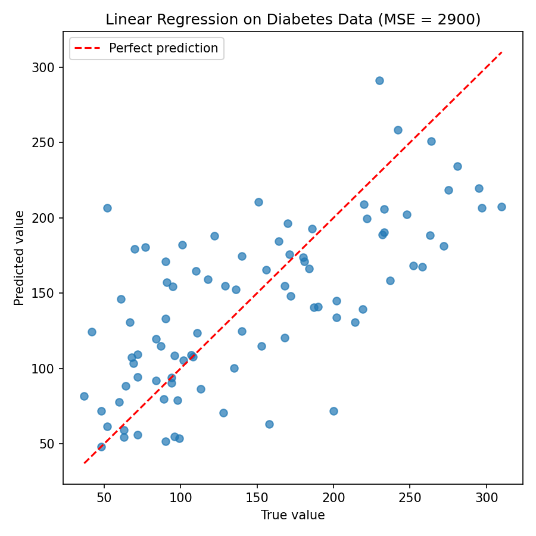

# ml-foundations

My hands-on notes and code while learning machine learning fundamentals.

## Week 1 — Linear Regression

**Script:** `linear_regression_diabetes.py`

Fits scikit-learn's `LinearRegression` on the built-in diabetes dataset (442 patients, 10 features), predicting disease progression one year later.

- 80/20 train/test split (`random_state=42`)
- **Test MSE: 2900.19** (RMSE ≈ 54)



**What I learned:** Points near the red line are good predictions. The model captures the overall trend, but the scatter is wide, so a straight line alone can't explain much of the variation in this data.

## Run it

```bash
pip install -r requirements.txt
python linear_regression_diabetes.py
```
